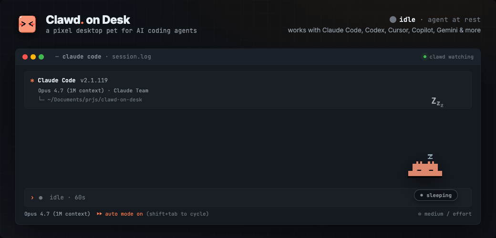
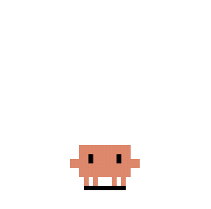
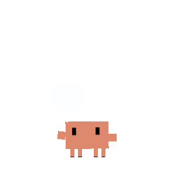
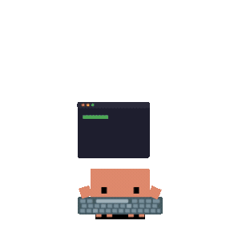
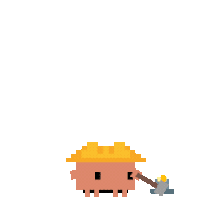
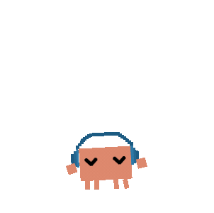
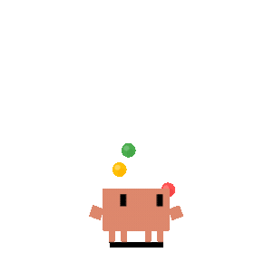
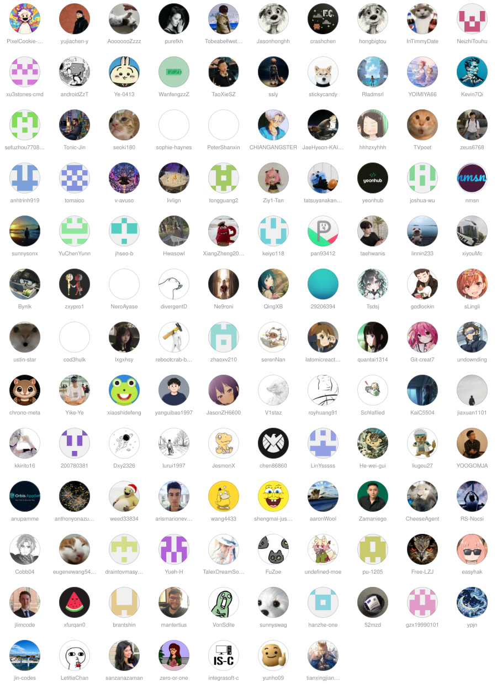

<p align="center">
  
</p>

<div align="center">
  <h1>Clawd on Desk</h1>
  <p><b>AI 코딩 에이전트의 상태에 실시간으로 반응하는 픽셀 데스크톱 펫.</b></p>
  <p><a href="README.md">English</a> · <a href="README.zh-CN.md">简体中文</a> · <a href="README.zh-TW.md">繁體中文</a> · 한국어 · <a href="README.ja-JP.md">日本語</a> · <a href="README.es.md">Español</a></p>
  <a href="https://github.com/rullerzhou-afk/clawd-on-desk/stargazers"></a>
  <a href="https://github.com/rullerzhou-afk/clawd-on-desk/releases"></a>
  
  <a href="LICENSE"></a>
  <a href="https://github.com/hesreallyhim/awesome-claude-code"></a>
  <a href="https://discord.gg/VQsQZbZCPx"></a>
</div>

<p align="center">
  
</p>

긴 작업을 시작하고 자리를 비웠다가, 크랩이 끝났다고 알려 주면 돌아오세요. 프롬프트를 보내면 생각하고, 도구가 실행되면 타이핑하고, 서브에이전트가 늘어나면 저글링하고, 승인이 필요하면 카드를 띄우고, 자리를 비우면 잠듭니다.

## 기능

- **실시간 상태**: 에이전트 hook과 로그로 움직이는 12가지 애니메이션 상태, 시선 추적, 수면 시퀀스, 클릭 반응, 화면 가장자리에서 빼꼼 내다보는 미니 모드
- **주요 도구 지원**: Claude Code, Codex, Copilot, Gemini, Cursor, opencode, Kiro, Qwen 등 20개 이상, 세션마다 따로 추적
- **권한 말풍선**: 떠 있는 카드나 전역 단축키로 도구 요청을 Allow / Deny하거나 자동 승인으로 전환
- **세션 한눈에 보기**: 펫 옆의 HUD, 터미널로 바로 이동할 수 있는 실시간 세션 대시보드, 할당량 링, 로컬에만 저장되는 활동 리캡
- **자리를 비워도**: Telegram이나 Feishu/Lark로 원격 승인, Slack 알림, 읽기 전용 모바일 PWA로 휴대폰에서 세션 확인
- **나만의 펫**: Clawd, Calico, Cloudling 기본 내장, 공식 테마 다운로드, Codex Pet 가져오기, 직접 만든 테마
- **어디서 코딩하든**: Windows(x64, ARM64), macOS, Linux, Remote SSH와 WSL 지원, UI는 7개 언어

전체 기능 설명: **[docs/guides/features.ko-KR.md](docs/guides/features.ko-KR.md)**

## 빠른 시작

**[GitHub Releases](https://github.com/rullerzhou-afk/clawd-on-desk/releases/latest)**에서 최신 설치 파일을 받으세요:

| 플랫폼 | 다운로드 |
|---|---|
| Windows | `Clawd-on-Desk-Setup-<version>-x64.exe` 또는 `-arm64.exe` |
| macOS | `.dmg` 또는 `brew install --cask clawd-on-desk` |
| Linux | `.AppImage` (앱 내 업데이트) 또는 `.deb` + [APT 설정 및 이전 안내](docs/guides/apt-setup.md) (x86_64에서는 Homebrew도 가능) |

Clawd를 실행하면 바로 반응하기 시작합니다. 첫 실행 때 Claude Code와 Codex가 자동으로 연결되고, 다른 에이전트는 **Settings → AI 코딩 도구**에서 클릭 한 번으로 설치합니다.

<details>
<summary><strong>소스에서 실행</strong></summary>
<br/>

기여, 미출시 코드 테스트, 통합 디버깅이 필요할 때만 사용하세요. 소스 설치는 Electron과 빌드 도구를 내려받기 때문에 `node_modules`가 커집니다.

```bash
# 저장소 복제
git clone https://github.com/rullerzhou-afk/clawd-on-desk.git
cd clawd-on-desk

# 의존성 설치
npm install

# Clawd 시작 (실행 시 Claude Code와 Codex hooks 자동 등록)
npm start
```

사전 요구 사항, Remote SSH, WSL, macOS / Linux 참고 사항: **[설정 가이드](docs/guides/setup-guide.md)**

</details>

## 지원 에이전트

> **Claude Code** · **Codex CLI** · **Copilot CLI** · **Gemini CLI** · **Antigravity CLI (agy)** · **Cursor Agent** · **CodeBuddy** · **WorkBuddy** · **Grok Build** · **Kiro CLI** · **KiroCrew** · **Kimi Code CLI (Kimi-CLI)** · **Qwen Code** · **ZCode** · **CodeWhale** · **opencode** · **MiMo Code** · **Pi** · **OMP** · **OpenClaw** · **Hermes Agent** · **Qoder** · **QoderWork** · **QwenWork (千问办公)** · **Reasonix CLI** · **DeepSeek Harness** · **TraeCode (Trae CN)** · **MiniMax Code**

Claude Code와 Codex CLI는 첫 실행 때 연결됩니다. 다른 통합은 **Settings → AI 코딩 도구**에서 설치하면 Clawd가 계속 동기화합니다. 그 밖의 로컬 도구는 [커스텀 HTTP 에이전트](docs/guides/custom-agent-http.md) 엔드포인트로 상태를 보낼 수 있습니다. 에이전트별 세부 사항은 **[지원 에이전트](docs/guides/supported-agents.ko-KR.md)**, 권한 말풍선이 없는 에이전트 같은 차이는 **[알려진 제한 사항](docs/guides/known-limitations.md)**에 있습니다.

## 테마

<table>
  <tr>
    <td align="center"><br><sub>대기</sub></td>
    <td align="center"><br><sub>생각 말풍선</sub></td>
    <td align="center"><br><sub>타이핑</sub></td>
    <td align="center"><br><sub>건설</sub></td>
    <td align="center"><br><sub>1개 서브에이전트</sub></td>
    <td align="center"><br><sub>2+ 서브에이전트</sub></td>
  </tr>
  <tr>
    <td align="center"><br><sub>Calico 대기</sub></td>
    <td align="center"><br><sub>Calico 생각</sub></td>
    <td align="center"><br><sub>Calico 타이핑</sub></td>
    <td align="center"><br><sub>Calico 건설</sub></td>
    <td align="center"><br><sub>Calico 저글링</sub></td>
    <td align="center"><br><sub>Calico 지휘</sub></td>
  </tr>
  <tr>
    <td align="center"><br><sub>Cloudling 대기</sub></td>
    <td align="center"><br><sub>Cloudling 생각</sub></td>
    <td align="center"><br><sub>Cloudling 타이핑</sub></td>
    <td align="center"><br><sub>Cloudling 건설</sub></td>
    <td align="center"><br><sub>Cloudling 저글링</sub></td>
    <td align="center"><br><sub>Cloudling 지휘</sub></td>
  </tr>
</table>

**Clawd**(픽셀 크랩), **Calico**(삼색 고양이), **Cloudling**(云宝)이 기본 내장되어 있습니다. **Hash Sage**(哈希仙人)와 **Whale-chan**(鲸鱼娘)은 **Settings → 테마**에서 받을 수 있는 선택형 공식 테마이고, 같은 곳에서 Codex Pet zip도 가져올 수 있습니다. 직접 그리려면 `npm run create-theme -- my-theme`를 실행하고 **[테마 제작 가이드](docs/guides/guide-theme-creation.md)**를 따라 하세요. 이벤트별 애니메이션: [상태 매핑](docs/guides/state-mapping.md).

커뮤니티 도구: @receyuki의 [Live2Pet](https://github.com/receyuki/live2pet)은 Live2D 모델을 Clawd 테마로 변환합니다.

## 가이드

| 가이드 | 내용 |
|---|---|
| [기능](docs/guides/features.ko-KR.md) | 모든 기능의 상세 설명 |
| [설정 가이드](docs/guides/setup-guide.md) | 소스 빌드, 에이전트 설정, Windows / macOS / Linux 참고 사항 |
| [권한 처리](docs/guides/setup-guide.md#permission-handling-automation) | 매번 묻기, 질문 프롬프트만, 자동 승인 |
| [Remote SSH](docs/guides/guide-remote-ssh.md) | 원격 서버 에이전트의 상태와 권한 말풍선 |
| [Codex + WSL](docs/guides/codex-wsl-clarification.ko-KR.md) | WSL 안의 Codex에 대한 Clawd 지원 범위 |
| [원격 승인](docs/guides/telegram-approval.md) | Telegram, 그리고 [Feishu / Lark](docs/guides/feishu-lark-remote-approval.md)와 [Slack 알림](docs/guides/slack-notifications.md) |
| [리캡](docs/guides/recap.md) | 로컬에만 저장되는 활동 리캡 |
| [커스텀 HTTP 에이전트](docs/guides/custom-agent-http.md) | 아직 통합되지 않은 도구 연결 |
| [알려진 제한 사항](docs/guides/known-limitations.md) | 에이전트별 기능 차이 |
| [테마 제작](docs/guides/guide-theme-creation.md) | 나만의 테마 만들기와 검증 |

## 커뮤니티

[Discord 커뮤니티](https://discord.gg/VQsQZbZCPx)에서 사용 도움을 받고, 테마와 데스크톱 구성을 공유하거나 아이디어를 나눠 보세요. 영어와 중국어로 소통할 수 있습니다. 버그는 추적할 수 있도록 [GitHub Issues](https://github.com/rullerzhou-afk/clawd-on-desk/issues)에 제보해 주세요.

## 기여하기

Clawd on Desk는 커뮤니티 주도 프로젝트입니다. 버그 리포트, 기능 아이디어, PR 모두 환영합니다. [issue](https://github.com/rullerzhou-afk/clawd-on-desk/issues)를 열어 논의하거나 바로 PR을 보내 주세요.

### 메인테이너

<p align="center">
  
</p>

### 기여자

Clawd를 더 좋게 만드는 데 도움을 준 모든 분들께 감사합니다:

<a href="https://github.com/rullerzhou-afk/clawd-on-desk/graphs/contributors">
  
</a>

## 감사의 말

- Clawd 픽셀 아트 참고: [clawd-tank](https://github.com/marciogranzotto/clawd-tank) by [@marciogranzotto](https://github.com/marciogranzotto)
- [LINUX DO](https://linux.do/) 커뮤니티에서 공유됨

## 라이선스

소스 코드는 [GNU Affero General Public License v3.0](LICENSE)(AGPL-3.0)로 배포됩니다.

**아트워크와 번들 테마 에셋(`assets/` 및 `themes/*/assets/` 포함)은 AGPL-3.0 라이선스 대상이 아닙니다.** 각 저작권자의 권리가 유지되며 자세한 내용은 [assets/LICENSE](assets/LICENSE)와 아래 고지를 참고하세요.

- **Clawd** 캐릭터는 [Anthropic](https://www.anthropic.com)의 자산입니다. 이 프로젝트는 비공식 팬 프로젝트이며 Anthropic과 제휴하거나 승인받지 않았습니다.
- **Calico cat (삼색 고양이)** 아트워크는 鹿鹿([@rullerzhou-afk](https://github.com/rullerzhou-afk))의 작품이며, 모든 권리를 보유합니다.
- **Cloudling (云宝)** 아트워크는 鹿鹿([@rullerzhou-afk](https://github.com/rullerzhou-afk))의 작품이며, 모든 권리를 보유합니다. Cloudling의 시각 방향에는 OpenAI Codex 로고에 대한 오마주가 포함되어 있습니다. Codex/OpenAI 관련 표장은 OpenAI의 자산이며, 이 프로젝트는 OpenAI와 제휴하거나 승인받지 않았습니다.
- **Whale-chan (鲸鱼娘)**은 [`rullerzhou-afk/clawd-themes`](https://github.com/rullerzhou-afk/clawd-themes)에서 선택형 공식 테마로 별도 배포됩니다. 원래 캐릭터와 설정 및 원본 소재의 권리는 각 창작자에게 있으며, 테마는 [Neko3000/deepseek-whalechan](https://github.com/Neko3000/deepseek-whalechan)에 명시된 ZipZipPipe와 上善无形을 표기합니다. 鹿鹿 ([@rullerzhou-afk](https://github.com/rullerzhou-afk))가 새로 만든 애니메이션과 효과는 CC BY-NC-SA 4.0을 따릅니다. 전체 조건은 테마 패키지에 있습니다. DeepSeek와 무관한 비공식·비상업 팬 작품이며 승인이나 후원을 받지 않았고, 이 프로젝트의 AGPL-3.0 소스 라이선스 대상이 아닙니다.
- **서드파티 기여물**: 저작권은 각 아티스트에게 유지됩니다.
