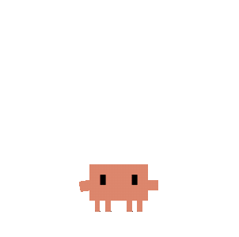
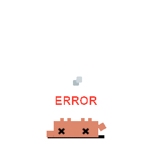
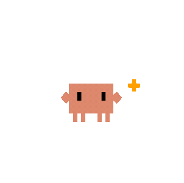
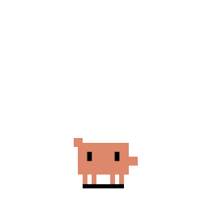
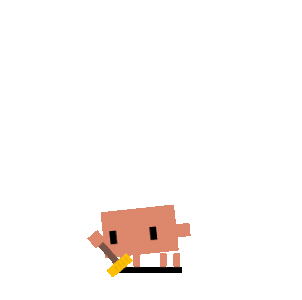
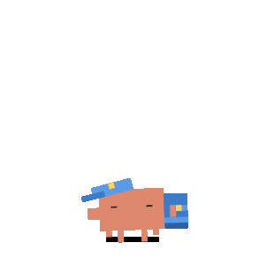

# 状态映射

[返回 README](../../README.zh-CN.md)

大多数 agent 生命周期事件会映射到同一组 Clawd 状态。

Subagent 事件仍映射到逻辑 `juggling` 状态，但 Clawd 主题现在会按 live 子代理数量选择分层素材：1 个子代理使用 `clawd-headphones-groove.svg`，2 个以上使用 `clawd-working-juggling.svg`。旧版 Clawd conducting 素材已退役；Calico 和云宝的 2+ 子代理分层仍使用各自的 conducting 动画。

下表的 idle 行描述主题原本的默认行为。用户也可以在“设置 → 动画 / 音效 → 动画”中，从当前主题声明的 idle 视觉里选择一个常驻静置造型。这个选项只改变逻辑状态为 `idle` 时显示的画面；任务、权限、完成、睡眠、互动反应和自由漫步仍会优先覆盖，结束后再回到所选造型。选择按主题分别保存，文件被主题更新删除时会回退到主题默认。非主题默认的 idle 视觉有意不启用鼠标眼球跟随或转圈头晕反应。

Clawd 还有一个条件触发的 Outlaw idle 彩蛋：同时选中西部牛仔帽和香烟时，一次符合条件的普通 idle 判定有 50% 概率播放 `clawd-outlaw-bender.svg`，冷却时间为 30 分钟。隐藏、低功耗、极简、漫游、拖拽、菜单打开和非 idle 期间都不消耗这次判定，也不推进冷却。该动画自带帽子和香烟，因此只在这一个文件里隐藏这两个外部配件图层。

| 事件 | 状态 | 动画 | Clawd | Calico | 云宝 |
|---|---|---|---|---|---|
| 无活动 | 待机 | 眼球跟踪 |  |  |  |
| 无活动（随机） | 待机 | 看书 / 巡逻 |  | |  |
| UserPromptSubmit | 思考 | 思考泡泡 + 灵感闪光 |  |  |  |
| PreToolUse / PostToolUse（1 个会话） | 工作（打字） | 打字 |  |  |  |
| PreToolUse / PostToolUse（2 个会话） | 工作（2 会话分层） | 耳机律动 |  |  |  |
| PreToolUse（3+ 会话） | 工作（建造） | 建造 |  |  |  |
| SubagentStart（1 个活跃子代理） | 杂耍 | 耳机律动 |  |  |  |
| SubagentStart（2+ 个活跃子代理） | 杂耍（2+ 分层） | 三球杂耍 |  |  |  |
| PostToolUseFailure | 报错 | 报错 |  |  |  |
| Stop / PostCompact | 注意 | 开心 |  |  |  |
| PermissionRequest | 通知 | 警报 |  |  |  |
| Codex `request_user_input` | 通知 | 警报 + 只读问题卡片 |  |  |  |
| PreCompact | 扫地 | 扫地 |  |  |  |
| WorktreeCreate | 搬运 | 搬箱子 |  |  |  |
| 60 秒鼠标静止 | 睡觉 | 睡眠 |  |  |  |
| SessionEnd | 删除会话；无其他 live 会话时回到 idle | 不触发睡眠过渡 | | | |

在 Clawd 主题下，直接执行 Claude Code 的 `/design` 命令会通过 `UserPromptExpansion` 选中画画造型。主会话被接受的 `Stop` 会选中爱心眼；这只表示一轮已完成，不表示发布成功。临时工具失败、通知和自动压缩会为续跑保留 design 提示，而终止性失败、会话结束和下一条普通 prompt 会清除它。两个造型都保留已选中的头部配件，并临时隐藏嘴部配件；在支持的普通姿势上嘴部配件会恢复。其他主题使用各自的状态视觉。

Claude Code 2.1.280 及以上版本还会注册 `PostToolBatch`。主会话中被接受的一个批次会在下一次模型请求前回到 `thinking`，但不会把该轮标记为完成。它要求当前 `prompt_id` 和精确、有界的工具身份；过早到达的批次会等待每个具名工具的普通关联证据。身份缺失或有歧义、存在待审审批、子批次、headless 会话和延迟到达的旧回调都不产生这次阶段变化。prompt 身份用于轮次关联，不做消息去重：追加的同 id 消息仍走正常处理，排队轮次可以在上一轮结束后由已识别的工具启动、无需再次 Submit，被否决的 Stop 之后出现的新工具可以继续该轮。轮次打开时遇到未出现过的 id 会停用阶段推断，但不退役这个打开的 prompt。无论 prompt id 如何，SessionEnd 都具权威性。已 settle 的成功尾段保留 thinking，同时保留元数据、权限清理和 AskUserQuestion transcript 完成回退；当前失败会播放报错提示，随后恢复既定的模型阶段。live 子代理提示保持自身优先级。较旧或未知的 Claude 版本不注册这个新批次 hook。该阶段事件不改变持久化的 recovery lease 或会话历史。2.1.280 这一门槛是保守的已验证基线，不代表这是支持该事件的第一个版本。详见 [Claude 的 hook 合约](https://code.claude.com/docs/en/hooks#posttoolbatch)。

## Kimi Code CLI（Kimi-CLI）Hook 事件

Kimi Code CLI（Kimi-CLI）现已采用 hook-only 集成（`~/.kimi/config.toml`），下面这 13 个 hook 事件会映射到 Clawd 的共享状态：

| Kimi Hook Event | 状态 |
|---|---|
| SessionStart | idle |
| SessionEnd | 删除会话；无其他 live 会话时回到 idle |
| UserPromptSubmit | thinking |
| PreToolUse | 默认映射到 working。payload 携带明确审批信号（`permission_required` / `requires_approval` / `waiting_for_approval` / `is_permission_request`）时始终立即切到 permission 类动画。在此之外，持久化模式决定门控工具的处理方式：**`suspect`（安装器默认）**启用延迟启发式——suspect 窗口内没等到 `PostToolUse` 就认定 Kimi 阻塞在审批 TUI 上并弹出提示；`explicit` 仅响应显式信号（现行 kimi-cli 从不发出，等于不弹卡）。安装脚本（`npm run install:kimi-hooks` 及启动时自动同步）把模式以 `--permission-mode=<mode>` 参数持久化到 `~/.kimi/config.toml` 的 `command` 字段，重新同步时保留既有选择。运行时环境变量优先级高于持久化参数：`CLAWD_KIMI_PERMISSION_MODE=explicit\|suspect`（压过持久化参数；但 `CLAWD_KIMI_DISABLE_PRETOOL_PERMISSION` 与 `CLAWD_KIMI_PERMISSION_IMMEDIATE` 的判定顺序在它之前）；`CLAWD_KIMI_PERMISSION_IMMEDIATE=1` 对门控工具强制立即映射；`CLAWD_KIMI_PERMISSION_SUSPECT=1`（旧别名）只对当前进程开启 suspect；`CLAWD_KIMI_PERMISSION_SUSPECT_MS=<ms>` 可调 suspect 窗口；`CLAWD_KIMI_DISABLE_PRETOOL_PERMISSION=1` 无论其他开关如何都保持 explicit-only。排队的门控调用由每会话的门控台账跟踪：每答复一个审批，就会为下一个待审批重新弹卡。 |
| PostToolUse | working |
| PostToolUseFailure | error |
| Stop | attention |
| StopFailure | error |
| SubagentStart | juggling |
| SubagentStop | working |
| PreCompact | sweeping |
| PostCompact | attention |
| Notification | notification |

## Gemini CLI Hook 说明

Gemini CLI 保持 hook-only 集成，但有两个 Gemini 原生事件有意不并入 Claude / Codex 的共享语义：

| Gemini Hook Event | Clawd 行为 |
|---|---|
| AfterAgent | 记录为 `AfterAgent`，会话回到 `idle`。它不重映射到共享 `Stop`，因此 Gemini 轮次不再自动显示 `attention` / 完成动画。 |
| PreCompress | 在会话历史中记录为 `PreCompress`，但不把桌宠切到 `sweeping`。当前可见状态（通常是 `thinking` 或 `working`）保持不变。 |

## ZCode Hook 事件

ZCode 使用 `~/.zcode/cli/config.json` 下的 config-file hooks：

| ZCode Hook Event | 状态 |
|---|---|
| SessionStart | idle |
| UserPromptSubmit | thinking |
| PreToolUse | working |
| PostToolUse | working |
| PostToolUseFailure | error |
| Stop | attention |
| PermissionRequest | notification（仅 fail-closed 路径） |

`PermissionRequest` 自 Phase 2 起是阻塞式权限审批：hook 等待 Clawd 本地气泡或远程审批产生人工决定，并通过 stdout 的 `hookSpecificOutput` 回答 allow/deny。在完成 ZCode 工具面与会话身份审计前，权限自动化会 defer。上表的 `notification` 映射只在 fail-closed 路径（tool name 缺失 / unknown）或 Clawd 未运行时触发；真正的决定不会 POST `/state`。当前集成没有 ZCode `SessionEnd` 事件，会话完成依赖 `Stop` 和 Clawd 原有的进程存活 / stale session 清理。当 Clawd 无决定时（超时、断连、DND、气泡关闭），hook 输出 `{}`，由 ZCode 原生权限流程接管。

## Grok Build Hook 事件

Grok Build 使用 `<GROK_HOME 或 ~/.grok>/hooks/clawd-on-desk.json` 下的 config-file hooks：

| Grok Hook Event | 状态 | 说明 |
|---|---|---|
| SessionStart | idle | |
| UserPromptSubmit | thinking | 在 turn fence 中记录最新轮次 |
| PreToolUse / PostToolUse | working | |
| PostToolUseFailure / StopFailure | error | |
| Stop（`reason="end_turn"`、无活跃后台任务 / cron、stop hook 未激活） | attention | 只表示一轮真正无阻塞地结束 |
| Stop（continuation 信号） | working，`event=null` | adapter 本地行为；不会锁定终态 |
| Stop（`channel_closed` / `shutdown` / 原因缺失 / 原因未知） | 丢弃 | 从不合成 Done；由真正的 `SessionEnd` 或 `idle_prompt` 收尾 |
| StopCancelled | idle | 不收尾为 Done；用于纠正同一轮里的 Stop 尾段 |
| Notification（`notificationType="idle_prompt"`） | notification | 播放一次提示，然后把会话存为 idle；fence 收尾该轮 |
| 其他 Notification | notification | 只做展示；不收尾当前轮次 |
| PreCompact | sweeping | |
| PostCompact（手动） | idle | 从不作为完成 |
| PostCompact（自动） | thinking | 从不作为完成 |
| PermissionDenied | notification（被动） | 不做决定；权限归 Grok 所有 |
| SessionEnd | 删除会话；无其他 live 会话时回到 idle | 清除 turn fence 记录 |

Grok 从不注册 `/permission`；adapter 始终输出 `{}`。Phase 1 不覆盖子代理事件（`subagentType`）以及 `SubagentStart` / `SubagentStop`。

## Pi Extension 事件

Pi 使用全局 extension（`~/.pi/agent/extensions/clawd-on-desk`），会把交互式会话生命周期事件映射到 Clawd 的共享状态：

| Pi Extension Event | Clawd Event | 状态 |
|---|---|---|
| session_start | SessionStart | idle |
| before_agent_start | UserPromptSubmit | thinking |
| tool_call | PreToolUse | working |
| tool_result (ok) | PostToolUse | working |
| tool_result (isError) | PostToolUseFailure | error |
| agent_end | Stop | attention |
| session_before_compact | PreCompact | sweeping |
| session_compact | PostCompact | attention |
| session_shutdown | SessionEnd | 删除会话；无其他 live 会话时回到 idle |

Pi 当前在 Clawd 中是 state-only 集成：Clawd 不接管权限、不新增确认弹窗，Pi 保持默认 YOLO 执行行为。

## OMP Extension 事件

OMP（oh-my-pi）使用按 agent 目录解析的 extension——默认环境下是 `~/.omp/agent/extensions/clawd-on-desk`——并把交互式会话生命周期事件映射到 Clawd 的共享状态：

| OMP Extension Event | Clawd Event | 状态 |
|---|---|---|
| session_start | SessionStart | idle |
| session_switch / session_branch | SessionStart | idle |
| before_agent_start | UserPromptSubmit | thinking |
| tool_call | PreToolUse | working |
| tool_result（成功） | PostToolUse | working |
| tool_result（isError） | PostToolUseFailure | error |
| session_stop 候选 + 随后的 agent_end（`willContinue !== true`） | Stop | attention |
| session_before_compact | PreCompact | sweeping |
| session_compact | PostCompact | attention |
| session_shutdown | SessionEnd | 删除会话；无其他 live 会话时回到 idle |

与 Pi extension 相比有三处刻意不同：

- **完成事件由 `session_stop` 与随后的 `agent_end` 共同确认。** `session_stop` 是 settle 前的聚合钩子：Clawd handler 跑完后，别的 extension 仍可请求隐藏续跑。Clawd 只在这里记录主会话候选，等 OMP 随后发出不带 `willContinue: true` 的 `agent_end` 才真正上报完成，因此调度暂停、内建重试和 extension 续跑都不会误播完成动效。
- **会上报 `session_switch` / `session_branch`，并为被离开的会话补发合成 `SessionEnd`。** OMP 可以把交互式终端切到另一段对话而旧会话没有任何 shutdown，否则 HUD 会留下一条再也不会更新的事件行。
- **始终发送 `session_title`。** 多个交互式 OMP 会话会合法地共用同一个工作目录，仅靠文件夹名回退会让每一行——以及每个跳转目标——显示成同一个名字。

OMP 在 Clawd 中同样是 state-only 集成：Clawd 不接管权限、不新增确认弹窗，OMP 保持自身的执行行为。

## Hash Sage（可选官方主题）

Hash Sage（哈希仙人）不随 Clawd 内置，而是从独立的 `rullerzhou-afk/clawd-themes` 仓库按需下载（设置 → 主题 → 官方主题）。它是外部 APNG 主题，已批准的 SVG 特效烘入每个 APNG，没有鼠标眼球跟随；逻辑状态与其他主题相同：

| 状态 | Hash Sage 动画 |
|---|---|
| idle | 空手待机 —— 站立呼吸（已批准的样片，完整 idle 组尚未定稿） |
| 鼠标静止 20 秒后的 idle 随机池 | 小云捉迷藏 —— 一朵小云飞过来，拖着金色轨迹绕她一圈，在她指尖玩耍后飞走；起止都停在 idle 姿势 |
| thinking | 掐诀推演 —— 掌中罗盘转动，代码符文升起 |
| working（1 会话） | 执笔制符 —— 写下验证符 |
| working（2 会话）/ juggling（1 个子代理） | 御剑 · 哈希符文 —— 双剑与哈希符文 |
| working（3+ 会话）/ juggling（2+ 子代理） | 忙碌协作 —— 两个纸灵来帮忙 |
| attention | 完成收功 —— 展开封印卷轴 |
| notification | 小铃轻唤 —— 摇响小铃 |
| error | 怎么又炸了 —— 符箓反噬 |
| sweeping / carrying | 拂尘引纸 / 牵云运匣 |
| yawning → dozing → collapsing → sleeping → waking | 哈欠入盹 → 托腮轻盹 → 云来安睡 → 云上代码梦 → 伸懒腰醒来 |
| DND 睡眠过渡 | 直接安睡 |
| 漫游、极简移动 | 乘云而行（朝向右侧绘制，向左时镜像） |
| 拖拽 / 双击 / 烦躁、连点 4 下 | 张手轻摆 / 小小吃惊 / 有点嫌弃 |
| 极简 idle / 入场 / 悬停探出 | 贴边探头 / 从右侧走入 / 探出与呼吸 |
| 极简 alert / 任务完成 / working | 摇铃 / 竖卷收功 / 挥符 |
| 极简入睡 / 睡眠（DND） | 闭眼入场 / 贴墙睡眠呼吸 |

卸载后重新下载是一次有损升级：它会清除该主题的自定义修改与 Clawd 管理的音效覆盖。

## Whale-chan（可选官方主题）

Whale-chan（鲸鱼娘）不随 Clawd 内置，而是从 `rullerzhou-afk/clawd-themes` 按需下载（设置 → 主题 → 官方主题），需要 Clawd 1.2.0。它是外部动图主题（主题 1.0.1 起为 WebP 动画），特效已烘入动画，没有鼠标眼球跟随；逻辑状态与其他主题相同。

| 状态 | Whale-chan 动画 |
|---|---|
| idle | 陪你发一会儿呆（站立呼吸） |
| 鼠标静止 20 秒后的 idle 随机池 | 大家一起来合奏（指挥，光环淡入淡出后回到 idle） |
| 默认 idle 造型选项 | 泡在泳池里偷个懒（只由设置选择，不进入随机池） |
| thinking | 认真想一想 |
| working（1 会话） | 今天也在努力呀 |
| working（2 会话）/ juggling（子代理） | 发现电饭煲啦 |
| working（3 个以上会话） | 撑着小伞去踩水 |
| attention / notification / error | 任务完成啦！/ 有件事要你确认哦 / 报错也要被接住 |
| sweeping / carrying | 把尾巴擦得亮晶晶 / 泡在泳池里偷个懒 |
| yawning → dozing → collapsing → sleeping → waking | 慢慢钻进纸箱里 → 在纸箱里轻轻呼吸 → 从纸箱飘进云朵 → 睡在软绵绵的云上 → 睡饱啦，回来陪你 |
| DND 深睡 / 漫游 / 极简移动 | 乘着云朵进入深睡 / 搭上鲸鱼巴士去兜风 |
| 拖拽 / 点击反应 | 被拎起来也要晃一晃 / 戳我干嘛，哼！ |
| 极简入场 / idle | 从屏幕边探出头来 / 趴在屏幕边陪着你 |
| 极简悬停探出 | 撑起身子看看你；鼠标停留时保持姿势（`mini-peek-hold`） |
| 极简 working / alert / task complete | 认真干饭中 / 叮！有事找你 / 砰！做完啦 |
| 极简入睡 / DND 睡眠 / 睡眠中悬停 | 闭着眼也来陪你 / 趴在屏幕边睡着了 / 睡着也撑起身子（`mini-sleep-peek`） |

重新下载已卸载的主题会清除该主题的自定义修改与 Clawd 管理的音效覆盖。

## 极简模式

拖到屏幕右边缘（或右键 →"极简模式"）进入——半身露出在屏幕边缘，悬停时探出来。

| 触发 | 极简反应 | Clawd | Calico | 云宝 |
|---|---|---|---|---|
| 默认 | 呼吸 + 眨眼 + 眼球追踪 |  |  |  |
| 鼠标悬停 | 探出身体 + 招手 |  |  |  |
| 通知 / 权限请求 | 警报弹出 |  |  |  |
| 任务完成 | 开心庆祝 |  |  |  |

## 点击反应

彩蛋——试试双击、连点 4 下、或反复戳 Clawd，会有隐藏反应。
